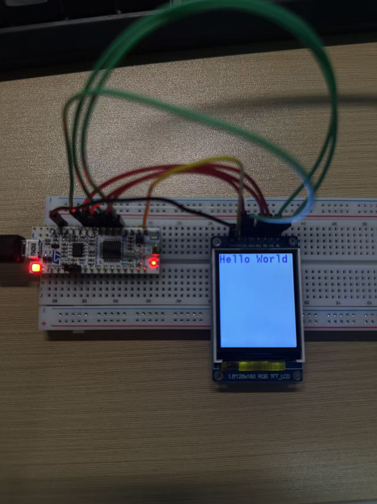

# STM32F0 外设实验

[English](README_EN.md) · [仓库首页](../../README.md)

这组实验包含 13 个可独立导入的 STM32F042K6T6 CubeIDE 工程。从点亮 LED 和读取输入出发，逐步实现 SPI 显示、ADC 采样、硬件定时、中断和 PWM 输出。

**实际效果。** 13 个工程已在 STM32CubeIDE 1.19.0 的 Debug 配置下生成 ELF。第 4 组实物图显示 ST7735 成功输出 **Hello World**。这张照片验证了显示实验，编译结果用于验证其余工程的工具链。

| 阶段 | 工程 | 烧录后的检查 |
| --- | --- | --- |
| GPIO 输出 | [2.1](lab2_1/)、[2.2](lab2_2/) | 观察 LED 输出序列。 |
| GPIO 输入与状态 | [3.1](lab3_1/)、[3.2](lab3_2/)、[3.3](lab3_3/) | 改变输入并观察输出。 |
| SPI 彩屏 | [4.1](lab4_1/) | 观察 ST7735 上的文本。 |
| ADC 与显示 | [5.1](lab5_1/)、[5.2](lab5_2/)、[5.3](lab5_3/) | 在允许电压范围内改变输入，核对屏幕读数。 |
| 硬件定时器 | [6.1](lab6_1/)、[6.2](lab6_2/) | 按配置核对定时周期和预期输出。 |
| 中断 | [7](lab7/) | 触发配置的外部输入，观察中断响应。 |
| PWM | [8.1](lab8_1/) | 用示波器观察 PWM 通道。 |

在 CubeIDE 中通过 **File → Import → Existing Projects into Workspace** 导入单个实验目录。从该工程的 .ioc 核对引脚和时钟，再构建 Debug。部分定时器例程保留原来的变量未使用警告。
