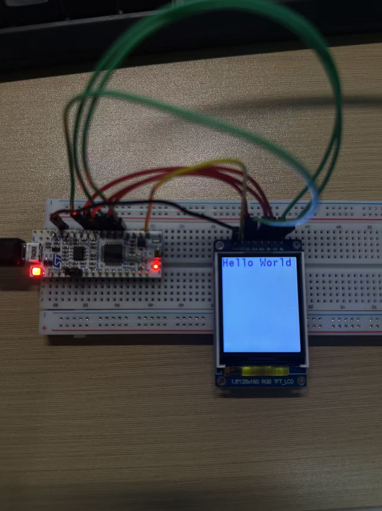

# STM32F0 Peripheral Labs

[简体中文](README.md) · [Repository home](../../README_EN.md)

This collection contains thirteen self-contained STM32F042K6T6 CubeIDE projects. It progresses from driving an LED and reading a switch to drawing text on SPI, sampling analog inputs, using timer periods and interrupts, and generating PWM.

**What worked.** All thirteen Debug builds produced ELF files in STM32CubeIDE 1.19.0. The original Lab 4 photo shows the ST7735 displaying **Hello World**. The photo verifies that display exercise and the build verifies the other projects' toolchain.

| Stage | Examples | Check after flashing |
| --- | --- | --- |
| GPIO outputs | [2.1](lab2_1/), [2.2](lab2_2/) | Watch the LED output patterns. |
| GPIO input and state | [3.1](lab3_1/), [3.2](lab3_2/), [3.3](lab3_3/) | Change the input and observe the response. |
| SPI display | [4.1](lab4_1/) | Observe text on the ST7735. |
| ADC and display | [5.1](lab5_1/), [5.2](lab5_2/), [5.3](lab5_3/) | Vary the analog input within the supply rails and check the display. |
| Hardware timer | [6.1](lab6_1/), [6.2](lab6_2/) | Check the configured timer period against the expected output. |
| Interrupts | [7](lab7/) | Trigger the configured external input and observe the ISR effect. |
| PWM | [8.1](lab8_1/) | Observe the PWM channel on a scope. |

Import a lab with **File → Import → Existing Projects into Workspace** and select its own directory. Open its .ioc for the pin and clock assignments, then build Debug. Some timer examples retain the original unused-variable warnings.
